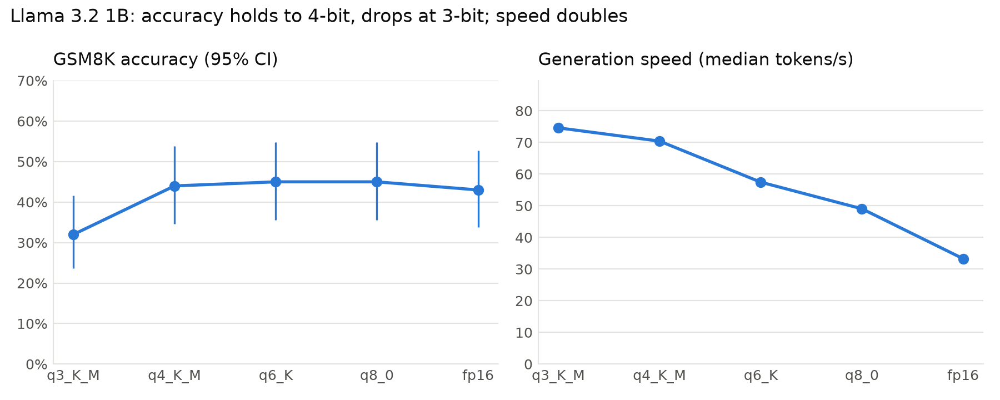
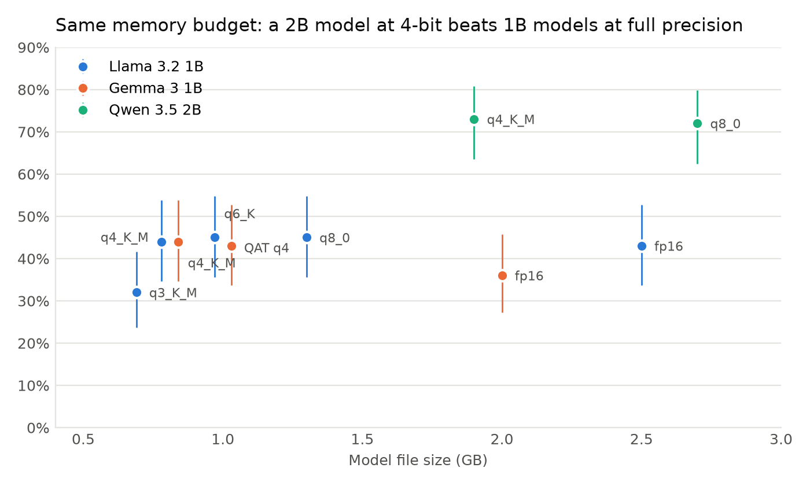
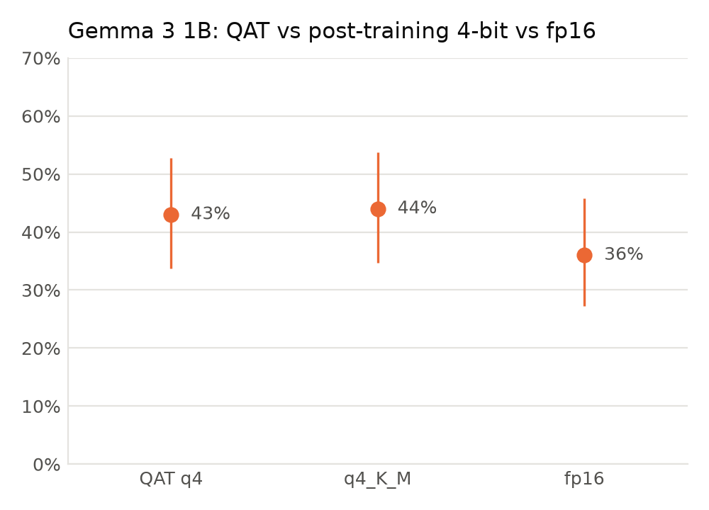
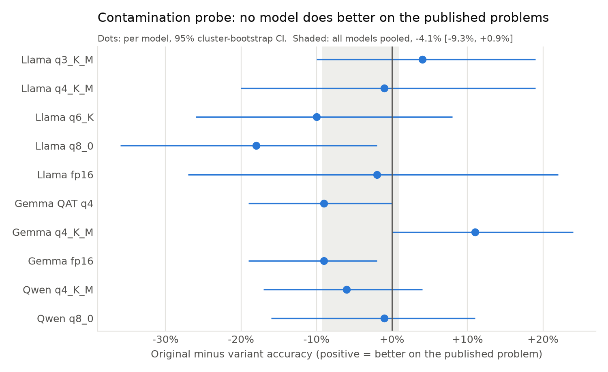

# How much accuracy do small open-weight models lose to quantization?

A controlled evaluation of 10 local model variants (Llama 3.2 1B, Gemma 3 1B, Qwen 3.5 2B; 3-bit to fp16) on GSM8K grade-school math, run through Ollama on a laptop. It asks three questions and checks one threat to the answers:

1. **Accuracy lost per bit.** How far can Llama 3.2 1B be quantized before it gets worse?
2. **QAT vs post-training 4-bit.** Does Gemma 3's quantization-aware-trained 4-bit model beat ordinary 4-bit quantization?
3. **Same memory budget.** At about 2 GB, is a 2B model at 4-bit better than a 1B model at full precision?
4. **Contamination.** GSM8K has been public since 2021. Do these models do better on the published problems than on fresh versions of them?

## Findings

| Question | Answer | Evidence |
|---|---|---|
| Accuracy per bit | **No measurable loss down to 4-bit; likely a drop at 3-bit.** 4-bit runs 2.1× faster than fp16. | q4/q6/q8 vs fp16: 44–45% vs 43%, p ≥ 0.77. q3 vs q4: 32% vs 44%, p = 0.04. |
| QAT vs 4-bit | **No consistent advantage.** | GSM8K: QAT 43% vs q4_K_M 44%, p = 1.0. Fresh variants: 39% vs 29%, but the two test sets disagree |
| Same budget | **The bigger model wins by a wide margin.** | Qwen 2B q4 (1.9 GB) 73% vs Llama 1B fp16 (2.5 GB) 43% and Gemma 1B fp16 (2.0 GB) 36%, p < 0.001 |
| Contamination | **No sign of memorization.** Models do no better on the published problems than on fresh variants. | Pooled gap (original − variant) −4.1%, 95% CI [−9.3%, +0.9%] |





<p float="left">
  
  
</p>

## Setup

| | |
|---|---|
| Hardware | Apple M3, 16 GB RAM |
| Runtime | Ollama 0.40.3, `/api/generate`, one request at a time |
| Data | First 100 items of the GSM8K test set; 100 contamination-probe variants |
| Decoding | `temperature 0`, `seed 42`, `num_predict 512`, Qwen thinking mode off |

| Model | File size | Notes |
|---|---|---|
| `llama3.2:1b-instruct-q3_K_M` / `q4_K_M` / `q6_K` / `q8_0` / `fp16` | 0.7 / 0.8 / 1.0 / 1.3 / 2.5 GB | Question 1 |
| `gemma3:1b-it-qat` / `it-q4_K_M` / `it-fp16` | 1.0 / 0.8 / 2.0 GB | Question 2 |
| `qwen3.5:2b-q4_K_M` / `2b-q8_0` | 1.9 / 2.7 GB | Question 3 |

### Controlled variables

Only the model changes between runs. Every model gets the same prompt, the same items in the same order, temperature 0 and a fixed seed, so a rerun gives the same output. Qwen 3.5 thinks before answering by default, in a separate hidden field; that gives it extra scratch space the other models don't have, so thinking is turned off and every model reasons only in its visible answer.

### Prompt and scoring

The prompt asks the model to work step by step and end with a line `Answer:<number>`. `parse_answer` reads the number after `Answer:`; if the line is missing, it falls back to the last number in the response and records the answer as unformatted.

The fallback gives credit to wrong answers. One Llama response worked its way to `10/3`; the last number in it is `3`, which happened to be correct. So results report **lenient** accuracy (any parsed answer that matches) and **strict** accuracy (it must also follow the format). They differ by 4–8 points for Llama and by at most 1 point for Gemma and Qwen.

Responses are stored in full (`results/*.csv`), so any change to the parser can be rescored without rerunning the models.

### Statistics

With 100 items, an accuracy has a 95% interval about ±10 points wide, so most differences between neighbouring quantization levels are noise. Three tools keep the conclusions honest:

- **Wilson intervals** for each accuracy.
- **Exact McNemar tests** for comparing two models. Both models answer the same items, so the test looks only at the items where they disagree. That is much more sensitive than comparing two accuracies as if they came from separate samples.
- **Eleven comparisons, read together.** At p < 0.05, one in twenty comparisons of identical models would still come out "significant", so p = 0.04 for q3 vs q4 is suggestive rather than settled; it would not survive a Bonferroni correction (0.05 / 11 ≈ 0.005). The Qwen results (p < 0.001) survive any correction.
- **Cluster bootstrap** for the contamination probe. The five variants of one problem are correlated (a model that can't do the problem usually misses all five), so the bootstrap resamples whole problems, not individual variants.

## Contamination probe

Following the approach of [GSM-Symbolic](https://arxiv.org/abs/2410.05229), GSM8K test items #0–#19 were rewritten as templates that keep the original wording and steps and change only names and numbers. Each template produces five variants (`fresh_templates.py` → `data/fresh_problems.jsonl`).

- **The 20 items were fixed in advance:** the first 20, in order, none skipped. Choosing items by how models scored on them would bias the comparison.
- **Every answer is a positive integer by construction.** Where a step divides, the quotient is drawn first and the dividend is built from it. One variant of every template was checked by hand.
- **Each model is compared with itself, problem by problem:** original correct (0/1) minus the share of its five variants answered correctly.

A first design used five hand-written templates with 20 variants each. It was dropped because 100 items from 5 templates are really 5 independent problems: the result would depend on which templates were written, and the error bars would be far too narrow. Deriving templates from GSM8K items also keeps difficulty matched by construction.

**Result:** pooled across all 10 models, the published problems are answered 4.1 points *less* often than their variants (95% CI −9.3 to +0.9). Any advantage from having seen these problems is at most about one point. Per-model gaps scatter in both directions. The two intervals that clearly exclude zero (Llama q8_0, Gemma fp16) both favour the variants, the opposite of what memorization would produce.

## Results

Two test sets are used: the first 100 GSM8K test items, and the 100 contamination-probe variants. The variants are a second, independent run of every model, so a finding that appears on both is a replication, not a single draw.

### Accuracy on GSM8K (n = 100, 95% Wilson interval)

| Model | Size | Accuracy | Strict | Format | Tokens/s | Hit 512 cap |
|---|---|---|---|---|---|---|
| Llama 3.2 1B q3_K_M | 0.7 GB | 32% [24–42] | 28% | 87% | 75 | 4% |
| Llama 3.2 1B q4_K_M | 0.8 GB | 44% [35–54] | 40% | 90% | 70 | 3% |
| Llama 3.2 1B q6_K | 1.0 GB | 45% [36–55] | 37% | 81% | 57 | 1% |
| Llama 3.2 1B q8_0 | 1.3 GB | 45% [36–55] | 37% | 83% | 49 | 1% |
| Llama 3.2 1B fp16 | 2.5 GB | 43% [34–53] | 35% | 81% | 33 | 1% |
| Gemma 3 1B QAT q4 | 1.0 GB | 43% [34–53] | 43% | 91% | 59 | 9% |
| Gemma 3 1B q4_K_M | 0.8 GB | 44% [35–54] | 44% | 94% | 52 | 5% |
| Gemma 3 1B fp16 | 2.0 GB | 36% [27–46] | 35% | 92% | 37 | 6% |
| Qwen 3.5 2B q4_K_M | 1.9 GB | 73% [64–81] | 73% | 92% | 37 | 7% |
| Qwen 3.5 2B q8_0 | 2.7 GB | 72% [63–80] | 71% | 89% | 31 | 11% |

### Replication on the fresh variants

| Model | GSM8K | Fresh variants |
|---|---|---|
| Llama 3.2 1B q3_K_M | 32% | 21% |
| Llama 3.2 1B q4_K_M | 44% | 41% |
| Llama 3.2 1B q6_K | 45% | 40% |
| Llama 3.2 1B q8_0 | 45% | 43% |
| Llama 3.2 1B fp16 | 43% | 42% |
| Gemma 3 1B QAT q4 | 43% | 39% |
| Gemma 3 1B q4_K_M | 44% | 29% |
| Gemma 3 1B fp16 | 36% | 24% |
| Qwen 3.5 2B q4_K_M | 73% | 61% |
| Qwen 3.5 2B q8_0 | 72% | 66% |

Questions 1 and 3 replicate: Llama is flat from fp16 to 4-bit and lowest at 3-bit, and Qwen leads every 1B model by 18+ points. Question 2 does not: QAT ties q4_K_M on GSM8K but leads it by 10 points on the variants. The variants come in correlated groups of five, so that gap is weaker evidence than it looks, and the honest reading is "no consistent difference".

### Paired comparisons (exact McNemar)

"A only" counts items A got right and B got wrong.

| Question | A | B | A | B | A only | B only | p |
|---|---|---|---|---|---|---|---|
| 1 | Llama q3_K_M | Llama fp16 | 32% | 43% | 11 | 22 | 0.080 |
| 1 | Llama q4_K_M | Llama fp16 | 44% | 43% | 12 | 11 | 1.000 |
| 1 | Llama q6_K | Llama fp16 | 45% | 43% | 12 | 10 | 0.832 |
| 1 | Llama q8_0 | Llama fp16 | 45% | 43% | 7 | 5 | 0.774 |
| 1 | Llama q3_K_M | Llama q4_K_M | 32% | 44% | 9 | 21 | 0.043 |
| 2 | Gemma QAT q4 | Gemma q4_K_M | 43% | 44% | 11 | 12 | 1.000 |
| 2 | Gemma QAT q4 | Gemma fp16 | 43% | 36% | 13 | 6 | 0.167 |
| 2 | Gemma q4_K_M | Gemma fp16 | 44% | 36% | 16 | 8 | 0.152 |
| 3 | Qwen q4_K_M | Llama fp16 | 73% | 43% | 37 | 7 | < 0.001 |
| 3 | Qwen q4_K_M | Gemma fp16 | 73% | 36% | 38 | 1 | < 0.001 |
| 3 | Qwen q4_K_M | Qwen q8_0 | 73% | 72% | 7 | 6 | 1.000 |

Even between fp16 and q4, the two models disagree on 23 of 100 items. The totals match, but the errors are not the same errors.

### Contamination probe

| Model | Originals (20) | Variants (100) | Gap [95% CI] |
|---|---|---|---|
| Llama 3.2 1B q3_K_M | 25% | 21% | +4% [−10, +19] |
| Llama 3.2 1B q4_K_M | 40% | 41% | −1% [−20, +19] |
| Llama 3.2 1B q6_K | 30% | 40% | −10% [−26, +8] |
| Llama 3.2 1B q8_0 | 25% | 43% | −18% [−36, −2] |
| Llama 3.2 1B fp16 | 40% | 42% | −2% [−27, +22] |
| Gemma 3 1B QAT q4 | 30% | 39% | −9% [−19, 0] |
| Gemma 3 1B q4_K_M | 40% | 29% | +11% [0, +24] |
| Gemma 3 1B fp16 | 15% | 24% | −9% [−19, −2] |
| Qwen 3.5 2B q4_K_M | 55% | 61% | −6% [−17, +4] |
| Qwen 3.5 2B q8_0 | 65% | 66% | −1% [−16, +11] |
| **All models pooled** | | | **−4.1% [−9.3, +0.9]** |

## Limitations

- **100 items per run.** Differences under about 10 points between two models are mostly not detectable. The answer to question 1 is "no measurable loss at this sample size", not "no loss".
- **Accuracy is a coarse measure of quantization damage.** A model can change many token choices before a final answer flips. KL divergence of the quantized model's next-token distribution from fp16 would show smaller differences; it needs log-probabilities, which this setup doesn't collect.
- **Speed is relative, not absolute.** Runs shared the laptop with other background jobs and memory was tight, so tokens/s is useful for comparing models with each other, not as a benchmark of the hardware.
- **Load time was not recorded.** Ollama returns `load_duration` with every response; capturing it would add start-up cost to the speed comparison.
- **The 512-token cap truncated some answers,** up to 11% for Qwen q8_0. Truncated answers usually lack an `Answer:` line and count as unformatted, which costs the most verbose models a little.
- **Question 3 compares different model families.** Qwen 3.5 is newer and trained differently from Llama 3.2 and Gemma 3, so its lead is not due to parameter count alone.
- **The contamination probe tests surface memorization only.** Changing names and numbers catches a model that recalls a specific problem and answer; it would not catch one that learned the problem's structure from training data.

## Reproduce

```bash
python -m venv .venv && source .venv/bin/activate
pip install -r requirements.txt

curl -L -o data/gsm8k_test.jsonl \
  https://raw.githubusercontent.com/openai/grade-school-math/master/grade_school_math/data/test.jsonl
python fresh_templates.py                      # writes data/fresh_problems.jsonl

ollama pull llama3.2:1b-instruct-q4_K_M        # ...and the other nine models listed above
python eval.py                                 # GSM8K   -> results/gsm8k_raw.csv
python eval.py --data data/fresh_problems.jsonl --out results/fresh_raw.csv
python analyze.py                              # results/summary.md and charts/*.png
```

| File | What it does |
|---|---|
| `eval.py` | Calls each model through the Ollama API, parses and scores answers, saves one row per model and item |
| `fresh_templates.py` | Contamination-probe templates for GSM8K items #0–#19 |
| `analyze.py` | Accuracy tables, Wilson intervals, McNemar tests, cluster bootstrap, charts |
| `results/` | Raw per-item results, including every model response |
